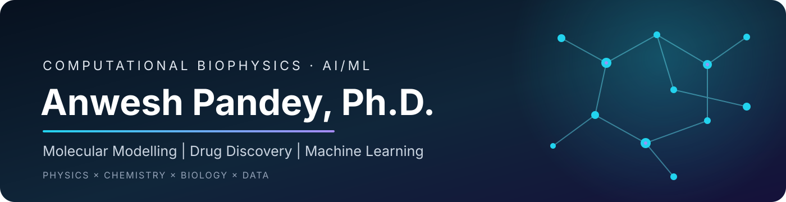
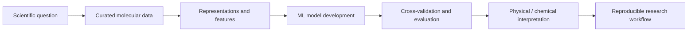

## Hello, I'm Anwesh 👋

I'm a computational biophysicist working at the intersection of **molecular modelling, non-covalent interactions, machine learning, and computer-aided drug design**. I hold a Ph.D. in Applied Physics, and my research connects physical insight about biomolecular recognition with computational and data-driven approaches.

I'm currently a **Postdoctoral Fellow in the Department of Computational Biology at IIIT Delhi**, working on AI/ML for ligand-based drug design, database development, and non-covalent interactions. Previously, I worked at the Hebrew University of Jerusalem on machine learning for enzyme catalytic activity prediction, protein electrostatics, and molecular modelling.

> **Research theme:** combining molecular-level understanding with reproducible computational workflows to make biomedical predictions more useful and interpretable.

## What I'm working on

- 🧬 **AI/ML for molecular science** — protein language models, molecular embeddings, and graph-based learning.
- 💊 **Computer-aided drug design** — ligand-based modelling, docking, molecular dynamics, and binding interactions.
- ⚛️ **Non-covalent interactions** — understanding and quantifying the forces behind molecular recognition.
- 🧪 **Scientific datasets** — curation, preprocessing, and database development for catalytic activity and molecular property prediction.
- 🛠️ **Research automation** — Bash/Python workflows and reproducible computational chemistry and biology pipelines.

## Research-to-model workflow

## Technical toolkit

**Machine learning & data science**

**Programming & workflows**

**Molecular modelling & simulation**

## Selected research

- **AI/ML for enzyme catalytic activity prediction** — protein sequence representations, data curation, and model development.
- **DNA–ligand interactions** — computational modelling of recognition, dynamics, and stability.
- **Non-covalent interactions in molecular systems** — computational characterization of interaction patterns and cooperativity.
- **Molecular cavitands and drug delivery** — modelling host–guest complexes and preparing datasets for binding-affinity prediction.
- **Computational drug discovery** — molecular docking, molecular dynamics, and structure-based analysis of potential therapeutic compounds.

## Selected publications

A few examples from my publication record:

1. **High Throughput Meta-analysis of Antimicrobial Peptides for Characterizing Class Specific Therapeutic Candidates: An In-Silico Approach** — *Probiotics & Antimicrobial Proteins* (2025).
2. **Modelling DNA-ligand interactions through variable force-field based MD simulations** — *Indian Journal of Chemistry* (2024).
3. **Discerning Potent CSF-1R inhibitors for Targeting and Therapy of Neuroinflammation using Computational Approaches** — *Journal of Biomolecular Structure and Dynamics* (2024).
4. **Tracing the Transition from Covalent to Non-covalent Functionalization of Pyrene through C-, N-, and O-based Ionic and Radical Substrates using Quantum Mechanical Calculations** — *RSC Advances* (2023).
5. **Binding propensity and selectivity of cationic, anionic, and neutral guests with model hydrophobic hosts: A first principles study** — *Journal of Computational Chemistry* (2023).

## GitHub activity

  
  

  

  

<b>Contribution map</b>

 

## Teaching, mentoring & collaboration

Alongside research, I enjoy teaching computational chemistry and biology, preparing hands-on training material, and mentoring students on molecular modelling, docking, simulation, and data-driven workflows. I have contributed to workshops and training programmes, including sessions on Python-based data mining and computer-aided drug discovery.

I'm interested in collaborations involving:

- AI/ML for molecular and protein science
- Ligand-based drug design and molecular interaction analysis
- Curated datasets for molecular property and enzyme activity prediction
- Computational chemistry, molecular dynamics, and reproducible research software

Physics-informed thinking. Reproducible computation. Better scientific tools.

